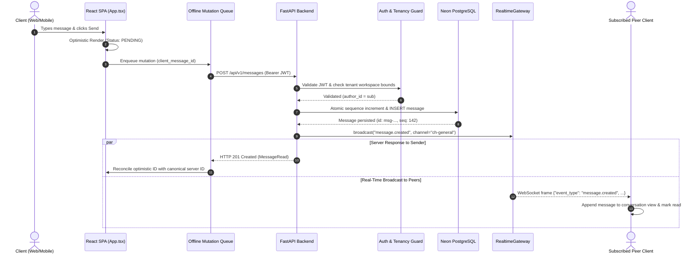
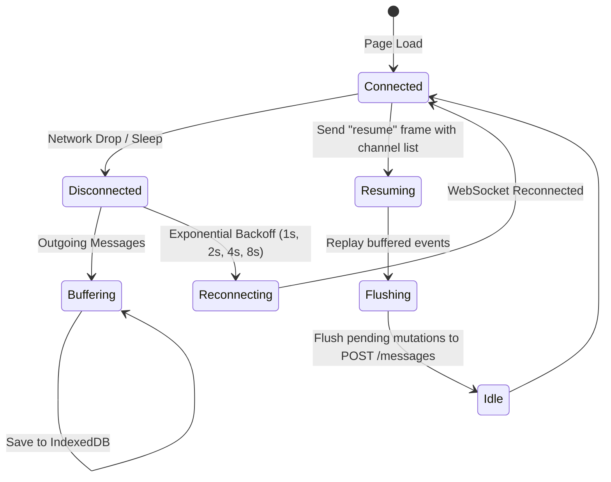

# Architecture & Data Flows

## 1. System Overview
The platform is designed as an end-to-end, multi-tenant collaboration engine structured around three core planes:
1. **Application & Client Plane:** React 19 / TypeScript SPA with offline mutation queues and WebSocket subscriptions.
2. **Control & Ingestion Plane:** FastAPI asynchronous application server enforcing authentication, authorization, rate-limiting, and sequence allocation.
3. **Storage & Persistence Plane:** Neon Lakebase PostgreSQL, Alembic migrations, and Realtime WebSocket event gateway.

---

## 2. End-to-End Message Data Flow

---

## 3. Real-Time Reconnection & Offline Sync Flow

---

## 4. Multi-Tenant Authorization Model
The system uses strict contextual tenancy isolation:
1. Every authenticated token contains:
   - `sub`: User ID
   - `role`: Role (`admin`, `member`, `guest`)
   - `permissions`: Scoped rights (`workspace.read`, `channel.create`, `message.create`, `audit.read`, etc.)
2. `ensure_tenant_boundaries(claims, workspace_id, organization_id)` ensures that clients cannot craft requests targeting workspaces or organizations outside their authorization boundary.
3. Any cross-tenant attempt immediately raises a `PermissionError` (HTTP 403 Forbidden).
